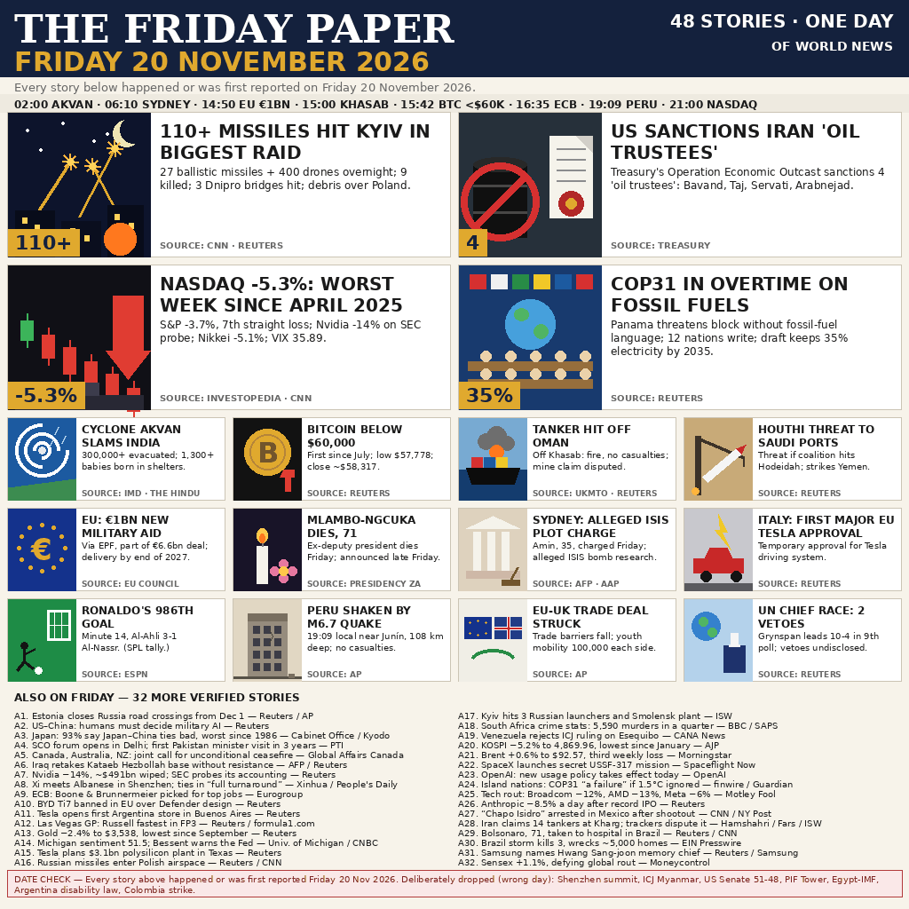

# Friday 20 November 2026 — One Day of World News, One Picture



One 1024×1024 newspaper image summing up world news of **Friday 20 November
2026**: 48 stories, 7 regions, every one of them happened — or was first
reported — on that Friday. No story from Thursday 19 November or earlier is
in the picture.

## The four leads

1. **Russian barrage hits Kyiv** — 110+ missiles, 400+ drones overnight; 8
   killed, 28 hurt; 3 bridges hit; debris falls in Poland.
2. **Cyclone Akvan hits India's coast** — landfall near Gopalpur 02:00 UTC,
   winds to 90 km/h, 300,000 evacuated, 9,341 shelters open.
3. **AI rout: Nasdaq falls 5.3%** — S&P 500 into correction; Anthropic −9%
   to near $88; Nasdaq −10% on the week; Nikkei −5.1% on Friday.
4. **COP31 draft drops fossil fuels** — final day ends with no deal; talks
   run into overtime; Panama threatens veto; Turkey lands $26bn+ in deals.

Plus 12 cards (Bitcoin at $61,700; 6.7 quake in Peru; Houthis threaten Saudi
ports; EU gives Ukraine 1bn euros in arms aid; South Africa mourns
Mlambo-Ngcuka; Australia, Canada and NZ urge a ceasefire; AFP foils an
alleged Sydney car-bomb plot; Tesla opens its first store in Argentina;
Nigeria to end jail for attempted suicide; TSMC and Samsung halt China chip
sales; Ronaldo's 986th goal; US sanctions 4 Iranians for oil money) and 32
more stories in the "Also on Friday 20 November" list, a timeline of the day
in UTC, and a schematic world map with pins for the 16 lead and card stories.

## Date audit — what was deliberately left out

The DATE CHECK box in the image names the big stories that were **not**
used because they belong to another day: the Shenzhen summit (19 Nov), the
ICJ Myanmar ruling (19 Nov), the US Senate Iran war-powers vote 51–48
(19 Nov), the Houthi hit on the Riyadh PIF Tower (19 Nov), the Egypt IMF
staff deal (18 Nov), the Argentina disability law (19 Nov), and the Colombia
national strike (19 Nov). None of them appears anywhere in the image. The
Trump–Iran interview was also Thursday 19 November US time, so it is not a
lead and does not appear in this entry at all.

The COP31 art label reads "35% ELECTRICITY SHARE BY 2035": the draft raises
electricity's share of final energy use to 35% by 2035 without requiring
renewables. The EU arms-aid package is 6.6bn euros. "CLAIM" marks a story
that is one side's account, not independently confirmed.

## Files

- `render.py` — draws the image from scratch with Pillow (stdlib + PIL),
  DejaVu fonts, simple original pictograms. Deterministic: repeated runs
  produce byte-identical PNGs.
- `entry.png` — the entry, 1024×1024, 212,030 bytes.
- `entry.png.b64` — the same PNG, base64-wrapped at 76 characters.
- `main.py` — stdlib only, no network. Decodes `entry.png.b64` and writes
  `/output/entry.png`, validating the PNG header, the 1024×1024 limit and
  the 1 MiB limit.

## Reproduce

```sh
python3 main.py        # writes /output/entry.png
python3 render.py      # regenerates entry.png (byte-identical)
```
